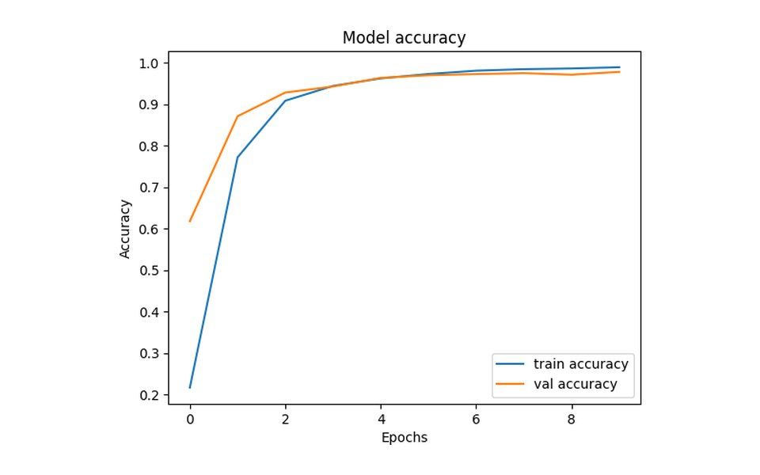

# Customer support intent detection

Reads a customer message and predicts which of 27 intents it expresses (cancel an order, track a refund, recover a password, and so on), so a support assistant can route or answer the request.



## Data

The Bitext customer support dataset: 26,872 labelled messages across 27 intents, close to 1,000 messages per intent. Template placeholders such as `{{Order Number}}` are removed, the text is tokenised with a 10,000-word vocabulary and padded to 100 tokens. The split is 70 / 30: 18,810 training and 8,062 test messages.

## Models

| File | Model |
| --- | --- |
| `intent_detection.ipynb` | Embedding (64) with global average pooling and two dense layers. This is the model the reported result comes from. |
| `bilstm_attention_model.py` | Bidirectional LSTM with an attention layer |
| `train_bilstm.py` | Training script for a bidirectional LSTM variant (300-dimensional embeddings, global average pooling) |
| `predict.py` | Loads a saved model, tokenizer and label encoder and predicts the intent of a typed message |

## Result

The averaged-embedding model reaches **98% accuracy on the 8,062 test messages** (validation accuracy 97.8% after 10 epochs), with macro precision, recall and F1 all at 0.98. Every intent scores an F1 of 0.95 or higher. The weakest are the ones that share wording: `change_order`, `cancel_order`, `place_order`, `create_account` and `delivery_options`.

The bidirectional LSTM models are included as heavier alternatives. No test result is recorded for them in this repository.

## Limits

The dataset is template-generated, so messages within an intent are phrased alike. Accuracy on free-form messages from real customers will be lower and should be measured before use.

## Run it

```bash
pip install -r requirements.txt
```

1. Download the Bitext customer support dataset and place the CSV next to the notebook. The notebook reads a version with an added `Paraphrase` column; only `instruction` and `intent` are needed for the classifier, so you can drop the `Paraphrase` references if you use the original file.
2. Run `intent_detection.ipynb`. It saves the model, the tokenizer and the label encoder.
3. Point the paths at the top of `predict.py` to the saved files and run `python predict.py`.

The dataset and trained weights are not stored in this repository.

## Author

Muhammad Umer Khan, [Neurals Solutions](https://neuralssolutions.com)

## License

MIT. See [LICENSE](LICENSE).
